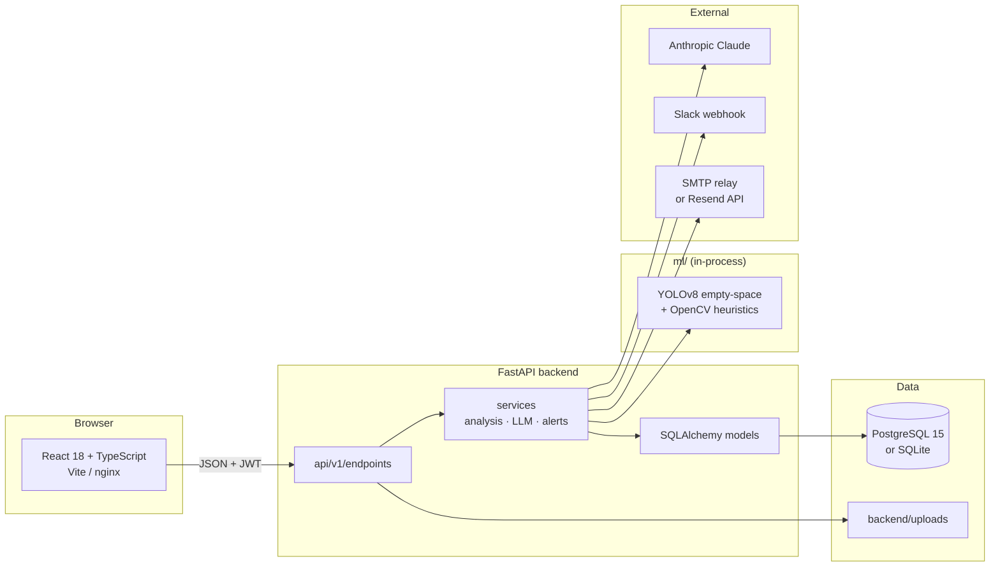

# ShelfMonitor — Retail Shelf Monitoring & Restocking Assistant


ShelfMonitor turns a photo of a retail shelf into a measured fill level, an actionable
restocking report, and an alert that reaches the people who can refill it — Slack and
email, automatically, with no per-account setup.

It is a full-stack monorepo: a **FastAPI** API, a **React + TypeScript** dashboard, a
**YOLOv8 + OpenCV** shelf analyser, and a background pipeline that ties them together with
**Claude**-generated reports and **Slack / SMTP** delivery.

---

## Table of contents

- [Why this exists](#why-this-exists)
- [Feature highlights](#feature-highlights)
- [Architecture](#architecture)
- [Tech stack](#tech-stack)
- [Repository layout](#repository-layout)
- [Quick start (Docker Compose)](#quick-start-docker-compose)
- [Manual setup](#manual-setup)
- [Configuration](#configuration)
- [How a capture is processed](#how-a-capture-is-processed)
- [Detection and confidence](#detection-and-confidence)
- [Alerting setup](#alerting-setup)
- [API overview](#api-overview)
- [Database and migrations](#database-and-migrations)
- [Frontend](#frontend)
- [Testing](#testing)
- [Troubleshooting](#troubleshooting)
- [Security notes](#security-notes)
- [Documentation](#documentation)
- [Roadmap](#roadmap)

---

## Why this exists

Empty shelves are usually discovered by walking the aisles — after a customer has already
seen the gap. ShelfMonitor closes that loop:

1. Staff upload a shelf photo from the dashboard.
2. A custom YOLOv8 model finds empty regions; OpenCV heuristics take over when the model
   has no signal.
3. The image is scored for usability first, so blurry/irrelevant photos are rejected with
   a clear explanation instead of producing confident nonsense.
4. Claude turns the measurement into a plain-language assessment and a concrete action,
   with a deterministic rule-based fallback when the LLM is unavailable.
5. High-urgency results alert Slack **and** every account in that store's email — no
   per-user configuration.
6. The dashboard keeps the history, alert feed, and per-aisle trends.

Every store only ever sees its own cameras, captures, reports, and alerts.

---

## Feature highlights

| Area | What you get |
|------|--------------|
| **Capture ingestion** | `202` upload receipt, background analysis, polling with a terminal `completed`/`failed` state |
| **Shelf analysis** | Custom empty-space detector, image quality gate, deskew, IoU-only NMS, heuristic fallback, coverage arbitration |
| **Assessments** | Claude tool-use JSON (`summary`, `urgency`, `recommended_action`) + rule-based fallback |
| **Honest confidence** | Zero-detection unassessed results are flagged `low_confidence` and shown as **"Unable to assess"**, never as 100 % full; they never alert or seed a trend |
| **Alerting** | Slack webhook + email, one installation-wide transport, recipients resolved from the store's `users` rows |
| **Email setup** | Credentials verified with a real test send **before** being written to `backend/.env`; bad pastes leave working settings untouched |
| **Multi-store isolation** | JWT auth; `store_id` always comes from the token, never from the request |
| **Reporting** | Filter by aisle / urgency / date, paginate, CSV export, per-report detail with detections |
| **Trends** | Fill % over time per aisle, with an accessible table view (colour is never the only signal) |
| **Health** | API, database, Slack, and email status with failure reasons, polled every 10 s |
| **Demo data** | Idempotent seed with stores, cameras, captures, reports, alerts, and a demo login |

---

## Architecture



The upload endpoint commits the capture, returns `202`, and hands the heavy work to a
FastAPI background task. That task opens its own database session, runs the analyser,
persists detections and the shelf report, raises alerts when warranted, and finally marks
the capture `ready` (API: `completed`) or `failed` with a message.

For a deeper walkthrough — module map, pipeline stages, deployment, and design
trade-offs — see [architecture.md](architecture.md).

---

## Tech stack

| Layer | Technology |
|-------|------------|
| **API** | FastAPI, Pydantic v2 / pydantic-settings, Uvicorn |
| **Auth** | JWT (HS256, PyJWT), bcrypt via passlib |
| **Persistence** | SQLAlchemy, Alembic, PostgreSQL 15, SQLite (dev) |
| **ML** | Ultralytics YOLOv8, OpenCV, NumPy |
| **LLM** | Anthropic Claude (`claude-3-5-haiku-20241022`) with forced tool use |
| **Alerts** | Slack Incoming Webhook, SMTP (STARTTLS/SSL), Resend-compatible email API |
| **Frontend** | React 18, TypeScript (strict), Vite 5, React Router 6, Tailwind CSS, Recharts, Lucide |
| **Testing** | pytest, Vitest, Testing Library |
| **Runtime** | Docker Compose (PostgreSQL + backend + nginx-served frontend) |

---

## Repository layout

```text
retail-shelf-monitor/
├── backend/
│   ├── app/
│   │   ├── api/v1/endpoints/     health, auth, captures, reports, alerts, stores, cameras
│   │   ├── core/                 config, database, JWT/bcrypt, auth guards, .env writer
│   │   ├── models/               SQLAlchemy tables
│   │   ├── schemas/              Pydantic request/response shapes
│   │   ├── services/             analyzer, capture pipeline, LLM, Slack, email
│   │   └── main.py               app factory, CORS, /uploads mount
│   ├── migrations/versions/      six Alembic revisions
│   ├── scripts/                  seed.py, set_resend_key.py
│   ├── tests/                    pytest suite
│   ├── Dockerfile
│   └── docker-entrypoint.sh      wait for Postgres → migrate → uvicorn
├── frontend/
│   ├── src/
│   │   ├── api/                  typed HTTP client + error helpers
│   │   ├── components/           AppLayout, HealthCards
│   │   ├── hooks/                useAuth, useHealth
│   │   ├── pages/                Dashboard, ShelfDetail, Alerts, Trends, Admin, Login, Signup
│   │   └── App.tsx               routes + auth gate
│   ├── nginx.conf
│   └── Dockerfile
├── ml/
│   ├── shelf_analyzer.py         quality gate, detection, fill %, CLI
│   ├── scripts/                  preprocess, detect, infer, train
│   ├── tests/                    analyser tests + fixtures
│   └── weights/empty_space_best.pt
├── docker-compose.yml
├── .env.example                  template for Compose
├── PRD.md · architecture.md · database.md · api.md · AGENTS.md
└── README.md
```

---

## Quick start (Docker Compose)

### Prerequisites

- Docker Desktop (or Docker Engine + Compose v2)
- ~4 GB free for images (CPU-only PyTorch is installed in the backend image)

### 1. Configure

```bash
cp .env.example .env
```

Edit the repo-root `.env`:

- `ANTHROPIC_API_KEY` — enables AI-written summaries (optional; a rule-based report is
  used otherwise).
- `SLACK_WEBHOOK_URL` — enables Slack alerts (optional).
- `POSTGRES_PASSWORD` — change it for anything beyond local use.
- `BACKEND_PORT` / `FRONTEND_PORT` — change if the defaults are taken.

Email is configured **inside the app** (Alerts → Email setup) or in `backend/.env`; see
[Alerting setup](#alerting-setup).

### 2. Build and start

```bash
docker compose up --build
```

The backend entrypoint waits for PostgreSQL to accept a real connection, runs
`alembic upgrade head`, then starts Uvicorn.

### 3. Open

| Service | URL |
|---------|-----|
| Dashboard | <http://localhost:5173> |
| API docs (Swagger) | <http://localhost:8000/docs> |
| Health | <http://localhost:8000/api/v1/health> |

### 4. Seed demo data (optional)

```bash
docker compose exec backend python scripts/seed.py
```

This creates two stores, five cameras, sample captures with generated images, reports,
alerts, and the demo login below. Re-running it is safe and idempotent.

### Demo login

| Field | Value |
|-------|-------|
| Email | `demo@shelfmonitor.test` |
| Password | `demo-2026-shelf` |

> The login page also offers a one-click **Try Demo Account** button. These credentials
> are intentionally public and local-development only — never reuse them for a hosted
> database.

---

## Manual setup

### 1. Database

Run PostgreSQL 15 locally, or use SQLite for a zero-setup database:

```env
# backend/.env
DATABASE_URL=sqlite:///./shelf_monitoring.db
```

### 2. Backend

```bash
cd backend
python -m venv .venv
# Windows
.venv\Scripts\activate
# macOS / Linux
source .venv/bin/activate

pip install -r requirements.txt
cp .env.example .env        # fill in the keys you need
alembic upgrade head
uvicorn app.main:app --reload --port 8000
```

The backend imports `ml/shelf_analyzer.py` in-process. Running it natively therefore
requires the ML dependencies too:

```bash
pip install -r ../ml/requirements.txt
```

### 3. Frontend

```bash
cd frontend
npm ci
npm run dev
```

Open <http://localhost:5173>. The dev server proxies `/uploads` to the backend so capture
images resolve without CORS problems.

### 4. ML (optional, for direct analysis)

```bash
cd ml
pip install -r requirements.txt
python scripts/detect.py --image path/to/shelf.jpg
python -m pytest tests/test_shelf_analyzer.py -q
```

`ml/weights/empty_space_best.pt` is the required custom checkpoint. The analyser refuses to
start without it rather than falling back to a stock COCO model (which would classify
people and vases as shelf gaps).

---

## Configuration

Settings are read from `backend/.env` by pydantic-settings. The repo-root `.env` is only
used by Docker Compose for interpolation. Templates with empty values live in
[`backend/.env.example`](backend/.env.example), [`.env.example`](.env.example), and
[`frontend/.env.example`](frontend/.env.example).

### Core

| Variable | Default | Purpose |
|----------|---------|---------|
| `PROJECT_NAME` | `Retail Shelf Monitoring & Restocking Assistant` | API title |
| `API_V1_STR` | `/api/v1` | API prefix |
| `ENVIRONMENT` | `development` | `production`/`staging` enforce a strong `SECRET_KEY` |
| `DATABASE_URL` | — | Explicit SQLAlchemy URL; overrides the Postgres parts |
| `POSTGRES_SERVER` / `_USER` / `_PASSWORD` / `_DB` / `_PORT` | `localhost` / `postgres` / `postgres` / `shelf_monitoring` / `5432` | Postgres connection |
| `UPLOAD_DIR` | `backend/uploads` | Where capture images are stored |
| `SECRET_KEY` | — | JWT signing key; **required** in production/staging (≥32 chars) |
| `ACCESS_TOKEN_EXPIRE_MINUTES` | `1440` | Token lifetime (1 day) |

Generate a secret:

```bash
python -c "import secrets; print(secrets.token_urlsafe(48))"
```

### AI and alerts

| Variable | Purpose |
|----------|---------|
| `ANTHROPIC_API_KEY` | Claude report generation (optional; rule-based fallback without it) |
| `ANTHROPIC_WORKSPACE_ID` | Optional workspace header for Anthropic |
| `SLACK_WEBHOOK_URL` | Slack Incoming Webhook for high-urgency alerts |
| `SMTP_HOST` / `SMTP_PORT` / `SMTP_USER` / `SMTP_PASSWORD` / `SMTP_FROM` | SMTP relay transport |
| `SMTP_USE_TLS` / `SMTP_USE_SSL` | STARTTLS (587) / implicit TLS (465) |
| `RESEND_API_KEY` | Email API transport (starts with `re_`) |
| `EMAIL_FROM` | Sender for the API transport |
| `EMAIL_API_URL` | Transactional endpoint (default `https://api.resend.com/emails`) |
| `ALERT_EMAIL_TO` | Comma-separated global recipient override |
| `ALERT_EMAIL_ENABLED` | Master switch for email (`false` keeps Slack alive) |

> SMTP takes precedence when both transports are set, because a relay can deliver to any
> login address while a free-tier API key generally cannot. Installing one transport
> retires the other.

### Frontend

| Variable | Where | Purpose |
|----------|-------|---------|
| `VITE_API_URL` | build time | Base API URL, e.g. `http://localhost:8000/api/v1` |
| `VITE_DEMO_EMAIL` / `VITE_DEMO_PASSWORD` | build time | Override the demo credentials shown on the login page |

`VITE_*` values are inlined by Vite during `npm run build`; changing them at runtime has no
effect. Rebuild the frontend image after changing them.

---

## How a capture is processed

```text
POST /api/v1/captures/upload
  │  validate content type, camera ownership, non-empty file
  │  store image under a UUID filename
  │  INSERT capture (status = processing)
  └─► 202 Accepted  { capture_id, status: "processing", report_url }

background task (process_capture)
  1. load image → quality gate (size, blur, brightness, shelf relevance)
  2. deskew → upscale small images to detector scale
  3. YOLOv8 empty-space detection (conf 0.25, IoU 0.5) → IoU-only NMS
  4. if no detections: OpenCV heuristic detector
     if partial detections: coverage arbitration may adopt the pixel measurement
  5. fill % = 1 − (union of empty boxes / image area), clipped to 0..1
  6. previous confident fill for the same camera (capture.id < current)
  7. Claude report (forced tool use) or rule-based fallback
  8. persist shelf report (+ low_confidence when applicable)
  9. if urgency == high and not low_confidence:
        Slack alert
        email every account in the store that owns the camera
        record the alert row
 10. capture.status = ready   (or failed + error_message on any error)
```

The dashboard polls `GET /captures/{id}/report` every 1.5 s (120 s timeout) and renders the
result, detections, and the previous fill for trend context.

---

## Detection and confidence

- **Model.** A fine-tuned YOLOv8 checkpoint trained to detect empty shelf space, shipped at
  `ml/weights/empty_space_best.pt` (≈6 MB).
- **Threshold.** Confidence `0.25` is deliberate: measured genuine detections sit at
  `0.39–0.88`, noise peaks at `0.035`, so `0.25` sits in the empty band between them.
- **Quality gate.** Too-small, blurry, very dark, or non-shelf images are rejected before
  inference with a user-facing message (e.g. "This photo is too blurry to analyse").
- **Heuristic fallback.** When the fine-tuned model has no signal on an otherwise valid
  photo, OpenCV cues (saturation, edges, floor/fixture exclusion) estimate product vs empty
  space instead of reporting a vacuous 100 % full shelf.
- **Arbitration.** If the cues say "mostly empty" but model boxes cover only a small part
  of the frame, the pixel-level assessment wins, because the model was trained on mostly
  stocked shelves.
- **`low_confidence`.** A zero-detection result that was *not* assessed is flagged. The UI
  must show "Unable to assess"; such rows are excluded from alerts and from trend
  baselines. A zero-detection result that *was* assessed is a legitimate full shelf.

---

## Alerting setup

A high-urgency, confident report triggers two channels.

### Slack

1. Create an Incoming Webhook in Slack.
2. Set `SLACK_WEBHOOK_URL` in `backend/.env` (or the Compose environment).
3. Restart the backend.
4. Verify from the dashboard with **Send test alert**, or:

```bash
curl -X POST http://localhost:8000/api/v1/alerts/test \
  -H "Authorization: Bearer <your-token>"
```

### Email

Recipients are resolved automatically: **every account in the store that owns the camera**
receives the alert at its login address. `ALERT_EMAIL_TO` overrides the list when set.
There is no per-user email setup.

Two transports are supported:

**SMTP relay (recommended).** One relay serves every account and can deliver to any address.

```env
SMTP_HOST=smtp.gmail.com
SMTP_PORT=587
SMTP_USER=your-account@gmail.com
SMTP_PASSWORD=your-google-app-password
SMTP_FROM=your-account@gmail.com
SMTP_USE_TLS=true
```

> Gmail requires an **App Password** (Google Account → Security → 2-Step Verification →
> App passwords), not the account password.

**Provider API key.** Paste a Resend-compatible key into **Alerts → Email setup**, or set:

```env
RESEND_API_KEY=re_xxxxxxxxxxxxxxxxxxxxxxxx
EMAIL_FROM=ShelfMonitor <alerts@yourdomain.com>
```

The setup dialog verifies the key with a real test send before writing anything to
`backend/.env`. On failure the previous settings are restored. A free-tier key can usually
only mail the account owner's address until a sending domain is verified — use SMTP if you
need every login address.

### Delivery truth in the database

Each alert stores `sent_to_slack`, `sent_to_email`, `email_recipients`, and `sent_at`
(Slack acceptance time). Missing credentials mean the channel is skipped and recorded as
not sent; the capture pipeline still completes.

---

## API overview

Base URL: `http://localhost:8000/api/v1` · Interactive docs: `/docs` · Full reference:
[api.md](api.md).

All private routes require `Authorization: Bearer <token>`. Errors use FastAPI's
`{ "detail": "…" }` shape. Lists return a `Page[T]` envelope
(`{ items, total, limit, offset }`), except `/stores` and `/cameras`, which return arrays.

| Method | Path | Purpose |
|--------|------|---------|
| `GET` | `/health` | API, database, and alert-channel health |
| `POST` | `/auth/signup` | Create a store + owner, return a JWT |
| `POST` | `/auth/login` | Log in |
| `GET` | `/auth/me` | Current account |
| `POST` | `/captures/upload` | Upload a shelf image (`202`, background analysis) |
| `GET` | `/captures/{id}/report` | Poll the report (`processing`/`completed`/`failed`) |
| `GET` | `/reports` | Filterable, paginated reports |
| `GET` | `/reports/export` | CSV export |
| `GET` | `/reports/{id}` | One report |
| `GET` | `/alerts` | Paginated alert feed |
| `GET` | `/alerts/email-config` | Email transport state |
| `POST` | `/alerts/email-config` | Verify and save an API key |
| `POST` | `/alerts/smtp-config` | Verify and save SMTP credentials |
| `POST` | `/alerts/test` | Send a test alert to Slack + your email |
| `GET` | `/stores` | Store directory |
| `POST` | `/stores` | Create a store |
| `GET` | `/cameras` | Cameras in your store |
| `POST` | `/cameras` | Create a camera in your store |

Minimal flow:

```bash
BASE=http://localhost:8000/api/v1

TOKEN=$(curl -s -X POST $BASE/auth/signup \
  -H "Content-Type: application/json" \
  -d '{"store_name":"Demo Store","email":"owner@example.com","password":"password123"}' \
  | python -c "import sys,json;print(json.load(sys.stdin)['access_token'])")

curl -s -X POST $BASE/captures/upload \
  -H "Authorization: Bearer $TOKEN" \
  -F "camera_id=1" -F "file=@shelf.jpg"

curl -s $BASE/captures/1/report -H "Authorization: Bearer $TOKEN"
```

---

## Database and migrations

Default tables: `stores`, `users`, `cameras`, `captures`, `detections`, `shelf_reports`,
`alerts`, and a reserved `products` table. Details, invariants, and the migration history
are in [database.md](database.md).

```bash
cd backend

# apply migrations
alembic upgrade head

# create a migration after changing a model
alembic revision --autogenerate -m "add x to y"
alembic upgrade head

# roll back one revision
alembic downgrade -1
```

Rules that keep migrations safe:

- Never edit an applied revision — add a new one.
- Use `op.batch_alter_table` for `ALTER` operations so SQLite works.
- New `nullable=False` columns need a `server_default`.
- Import `app.models` before autogenerate.

### Seed data

```bash
cd backend
python scripts/seed.py
```

Creates 2 stores, 5 cameras, 5 captures with generated images, their reports and
detections, 2 high-urgency alerts, and a demo account (only if `users` is empty). Lookups
make re-runs idempotent.

---

## Frontend

| Route | Page | Notes |
|-------|------|-------|
| `/login`, `/signup` | Auth | Standalone pages, one-click demo login |
| `/` | Dashboard | Upload, poll analysis, filter reports, CSV export |
| `/reports/:id` | Report detail | Image, detection overlay, LLM assessment, previous fill |
| `/alerts` | Alerts | Alert feed, test alert, email/SMTP setup |
| `/trends` | Trends | Fill % over time per aisle; chart + table view |
| `/admin` | Directory | Stores and cameras; add a camera |

Authentication state lives in `localStorage` and is validated with `GET /auth/me` on load.
`useAuth` broadcasts changes to module-level listeners, and `src/api/client.ts` attaches the
Bearer token to every request. Route-level pages use `AbortController` and explicit
loading/error states. Map-based pages (`Trends`) are lazily loaded so Recharts stays out of
the initial bundle.

Production builds are served by nginx with SPA fallback and immutable caching for hashed
assets.

---

## Testing

### Backend

```bash
cd backend
python -m pytest
python -m pytest tests/test_captures_endpoint.py -q
```

Covers auth, upload/report flow, tenant isolation, report filters/pagination, alert
delivery flags, email configuration, health, timestamps, and an end-to-end capture flow.
`tests/conftest.py` blanks every email credential for each test, so **no test can send real
mail**; Slack is mocked at the `httpx` boundary.

### ML

```bash
cd ml
python -m pytest tests/test_shelf_analyzer.py -q
```

Covers geometry, NMS, fill math, and the quality gate. Do not weaken thresholds to make a
fixture pass; recalibrate deliberately and record the measurement in the comment.

### Frontend

```bash
cd frontend
npm test          # vitest run
npx tsc --noEmit  # strict typecheck
npm run build     # tsc && vite build
```

Tests use Vitest + Testing Library in `__tests__/` directories, with the API client mocked —
no running backend required.

---

## Troubleshooting

| Symptom | Cause and fix |
|---------|---------------|
| Tokens stop working after every restart | `SECRET_KEY` is unset, so a random per-process key is used. Set it in `backend/.env`. |
| `SECRET_KEY must be set` at startup | `ENVIRONMENT=production`/`staging` requires a ≥32-character key. |
| Alerts show "Not sent" | No transport configured or delivery failed. Check `/health` → `alert_email`, and the backend logs. |
| `POST /alerts/test` returns `503` | Neither Slack nor email is configured. `502` means configured but every channel failed. |
| Email reaches only one address | You are on a free-tier API key. Configure SMTP, which can mail every login address. |
| Capture stuck at "processing" | The process restarted mid-pipeline; there is no durable queue yet. Re-upload the capture. |
| Upload rejected as blurry/dark | The image quality gate refused it. Take a sharper, brighter shelf photo. |
| `libGL.so.1` error with OpenCV | Install the OpenGL runtime (the Docker image already includes it). |
| Duplicate stores after seeding | Older seed versions were not idempotent. Reset the database and reseed (see [database.md](database.md)). |
| Deep link 404s in production | nginx must serve the SPA fallback (`try_files … /index.html`); the provided config does. |
| Frontend calls the wrong API host | `VITE_API_URL` is baked in at build time; rebuild the frontend. |

Logs:

```bash
docker compose logs -f backend
docker compose logs -f db
```

---

## Security notes

- **No credentials in the repository.** `.env` files, database files, uploads, logs, and
  local key drop-boxes are git-ignored; only `.env.example` templates with empty values are
  committed. Never paste a real key into an example file, test, issue, or README.
- **Secrets stay server-side.** API keys are masked in responses, never logged, and never
  returned by configuration endpoints.
- **Passwords** are bcrypt-hashed and truncated to 72 bytes consistently on hash and verify.
- **Tenant isolation** is enforced server-side: `store_id` comes from the JWT, and camera
  ownership is verified before reads and uploads. Reports outside a store return `404`.
- **Uploads** are treated as untrusted: content type is validated, filenames are generated,
  and files are served from a fixed static directory.
- **Development-only defaults.** CORS currently allows `*` and JWTs live in `localStorage`.
  Before a public deployment, narrow CORS to known origins and consider httpOnly,
  SameSite cookies with CSRF protection.
- **Rotate any key** that has ever been shared, committed, or pasted into chat.

---

## Documentation

| Document | Contents |
|----------|----------|
| [PRD.md](PRD.md) | Product requirements, personas, functional/non-functional requirements, limitations, roadmap |
| [architecture.md](architecture.md) | System design, module map, pipeline, deployment, trade-offs, extension points |
| [database.md](database.md) | ER diagram, every table and column, migrations, invariants, queries, seeding |
| [api.md](api.md) | Full HTTP reference with request/response examples and status codes |
| [AGENTS.md](AGENTS.md) | Coding rules, commands, testing and security conventions |
| [README.md](README.md) | This overview and setup guide |

---

## Roadmap

- Durable job queue (Celery/RQ) with retries instead of in-process background tasks.
- Alert acknowledgement and a de-duplication window per camera.
- Per-user notification preferences and digest emails.
- Role-based access (owner / staff / viewer).
- SKU-level recognition and planogram comparison.
- HTTP-only cookie sessions with CSRF protection and narrowed CORS.
- CI running backend tests, frontend typecheck/tests, and documentation link checks.
